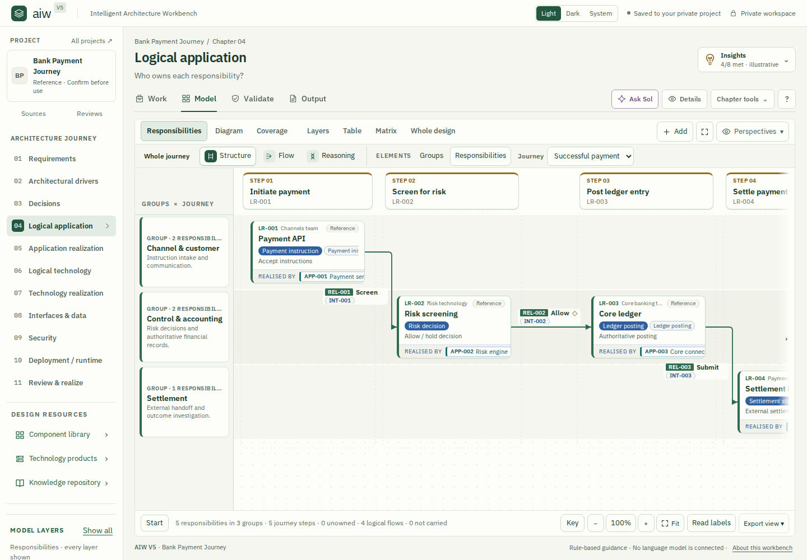
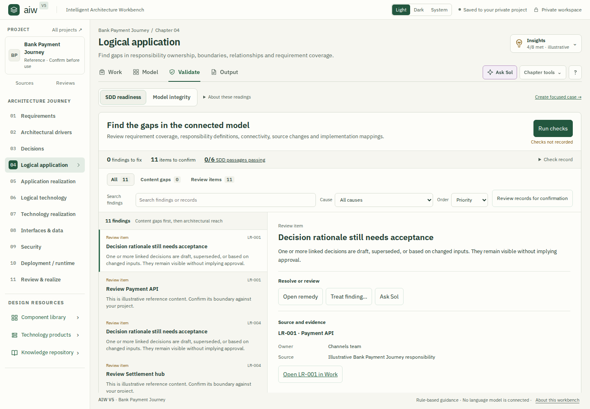
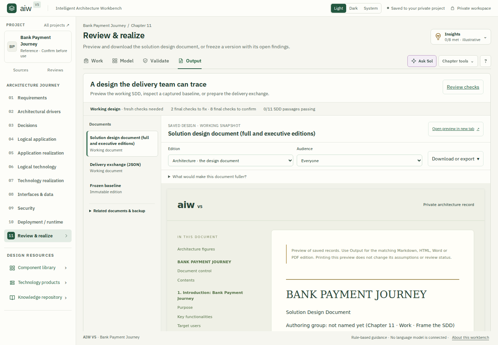

# AIW studio rethink — Round 28

Release: `AIW v0.10.0-rc.10.73.28+studio.20261018`  
Review date: 18 October 2026

## Basis and intent

This pass uses the attached Round 26 source as the product baseline and preserves useful capabilities from the subsequently published Round 27 implementation. The attached ZIP has SHA-256 `6490473d38209da62710df4903e5ff7c81f2c21ab17ec936bc3130511687531b`. The changes replace the workspace composition and chapter presentation contracts; they do not migrate project data or redefine architecture approval.

The previous layout repeated explanations, readiness summaries, assistance controls and record identities before the actual task. Model controls competed with the diagram, Validate scattered findings and supporting information, and Output emphasized links before the generated document. Round 28 gives each tab a distinct job and retains its chapter-specific tools.

| Tab | User's task | Implemented structure |
| --- | --- | --- |
| Work | Define and maintain the chapter's design records | Section navigation, one task heading with relevant actions, native collection or editor, optional record Details. Progress and private notes are disclosures. |
| Model | Understand relationships and interrogate the design | Stable labeled views, relevant modeling commands, a large canvas, consistent camera controls and export. Native chapter views, shared diagram/table/matrix views and saved perspectives remain available. |
| Validate | Understand and resolve what prevents a defensible design | Readiness and check freshness, prioritized finding queue, selected finding with remedies, source evidence and connected records. Filters, search, cause and ordering remain explicit. |
| Output | Inspect and produce the chapter's deliverables | Document selector, generated preview, formats and options, then source/readiness and handoff details. Working documents, frozen baselines and delivery exchanges retain separate meanings. |

## Chapter review

| Chapter | Context preserved and refinement delivered |
| --- | --- |
| 1 · Requirements | Brief, context/journey and requirement authoring remain distinct Work tasks. Model retains story and shared views. Source assurance stays accessible in Validate. Output previews the requirements document and chapter SDD contribution. |
| 2 · Architectural drivers | Driver editing, prioritization and comparison keep their specialized layouts. Priority and comparison now honor module scope while preserving canonical global ranks. Relevant cross-module conflicts remain explicitly identified. |
| 3 · Decisions | Decision authoring, alternatives and rationale remain native. Trade-off modeling and decision prerequisites remain enforced. Decision outputs and MADR export retain their existing semantics. |
| 4 · Logical application | Responsibilities, groups, flows and coverage retain native editors and models. Repeated record identity and empty inspector space are removed. Validation connects ownership and coverage findings to their source records. |
| 5 · Application realization | Components, realization mappings and specialist record lenses remain available. Model view transitions and the Layers/Focus controls operate within the common frame. Component specification outputs remain selectable per record. |
| 6 · Logical technology | Capabilities and application needs retain their own Work sections and prerequisite relationships. Native platform modeling uses the same view, camera and export conventions. |
| 7 · Technology realization | Technology selection and realization continue to require their source capabilities. Stack modeling and source-linked findings retain their chapter context. |
| 8 · Interfaces & data | Interface and data definitions retain native editing and exchange modeling. OpenAPI, AsyncAPI and schema exports remain conditional on the recorded definitions; the UI does not invent missing contract information. |
| 9 · Security | Threats, controls and their relationships retain native authoring and threat views. Mixed-record Table columns use neutral shared headings while retaining the exact field label on each cell. |
| 10 · Deployment / runtime | Environment, placement and runtime definitions retain their specialized controls and deployment views. Validation remedies and outputs continue to read the saved runtime design. |
| 11 · Review & realize | Narrative, governance, baselines and delivery workflows remain distinct. Validate separates final checks from inherited findings. Output opens the working SDD directly and retains edition/audience controls, frozen editions and delivery exchange. |

## Cross-chapter behavior

- One chapter purpose, one global Ask Sol entry point, optional Details, and chapter tools replace repeated assistance bands. Chapter Insights retain the next recommended action.
- Selecting a record opens its details deliberately. Closing Details persists through redraws of the same selection. Phone and tablet overlays have a visible close button and Escape support.
- Model view selection stays in place. Add menus remain within the model frame; focused layers remain clickable. Saved perspectives return to native views without losing the relevant controls.
- Saved journey mappings route to their actual chapter objects. Ambiguous or missing mappings are explained rather than replaced with an invented target.
- Validation uses existing findings, architectural reach, cause explanations, source evidence and native actions. Checks, confirmation, treatment and approval retain separate authority.
- Ask Sol retains the current chapter and record context. The local walkthrough has no configured language-model provider; provider-dependent answers are not claimed as verified intelligence.
- Phone Output uses a document selector; desktop uses an artifact list. Generated HTML previews are read from the saved design, with the existing downloadable formats retained.

## Verification evidence

The implementation was installed and run locally. A blank synthetic clinic project was created through the UI and authored from Chapter 1 through Chapter 11. All 44 Work/Model/Validate/Output surfaces were exercised. The main deep pass recorded 2,745 click events; focused follow-ups covered additional conditional controls and verified fixes. Blank and populated fixtures, domain regression checks and responsive inspection supplement that walkthrough. The [saved walkthrough](audit/round28/BROWSER-WALKTHROUGH.md), [command ledger](audit/round28/browser-command-families.csv) and [download manifest](audit/round28/browser-download-manifest.json) retain the detailed evidence and coverage limits. Click-event totals include repeated interactions and do not mean every distinct button was clicked.

Measured at 1440 × 1000, the Chapter 4 native model canvas starts at y=300 and provides approximately 611px of drawing height, compared with y=500 and 381px before this pass. The canvas is wider when Details is closed. The initial camera preserves readable labels; Fit remains available for the whole diagram.

Responsive checks cover Work, Model, Validate and final Output at 1440, 1024 and 390px. All twelve routes have zero document-level horizontal overflow and no JavaScript errors. Phone and tablet Details close successfully. The phone Model footer stays within the frame. Dark mode was visually inspected.

Focused checks cover structured Work composition across all chapters, native editor opening/cancellation, module scope, undo, linked-record pickers, chapter progress, journey mappings, model view and camera lifecycle, validation confirmation, generated output selection and SDD options. Assertions that depended on the previous presentation were updated; domain readiness and prerequisite rules were retained.

The output walkthrough completed 23 generated inline previews and new-tab opens, plus 33 successful downloads (32 unique files), with no browser or HTTP errors. Additional format and frozen-baseline checks bring the validated download inventory to 41 unique files, including PDF, DOCX, MADR ZIP, OpenAPI/schema JSON, recovery NDJSON and baseline documents. Full-diagram SVG and PNG exports were separately downloaded successfully; these remain distinct from visible-viewport exports. The authored project and its stored objects were preserved together at revision 82 and reopened successfully.

An independent final review found a Chapter 11 filter transition defect: a hidden inherited source-chapter filter could suppress the final-review queue. A DOM interaction test first reproduced zero visible final findings, then verified all ten after the fix, including returning to an unfiltered inherited queue. All 22 blank/populated validation-output fixture combinations pass.

The complete production build resolves 224 server modules, verifies the packaged Worker imports, and checks embedded assets byte-for-byte in compressed and uncompressed responses. Bundle-size gates remain active. The final client entry is `app-EGGGDY6S.js`, with stylesheet `app-bb38cdfb641c.css`.

The deep click pass used `app-JEYY45XJ.js` and found one further application defect: Chapter 10 Co-design referred to a runtime-plan variable outside its scope. Build `app-N3STZ3PP.js` uses the canonical current-plan context. A regression test covers seven contexts across all four tabs and project/plan/asset/blank selections, including the actual Ask Sol to Co-design transition, with stable routing and selection and no writes or errors. All four affected browser tab contexts and ten runtime editor actions subsequently passed.

The focused follow-up also completed Chapter 5's four remaining shared views. It captured baseline BL-001, “Synthetic QA baseline — not approved,” as a Working draft with no governance records, then opened its frozen previews and downloaded Markdown, HTML and JSON. Handoff correctly remained blocked by the missing architect review, approval and current action review. The authored project persisted at revision 82 after graceful shutdown.

That baseline exercise found misleading governance wording: the capture author was described as the architect reviewer when no review existed. Build `app-ZIBBVAWD.js` explicitly distinguishes capture from review, without changing approval or handoff guards. A new dialog regression test covers an unreviewed draft, a separately named reviewer and a legacy review without an author. The corrected wording was also verified in the running browser.

The supplemental native-proposal walkthrough found that Chapter 8 could generate a proposal while its Data flow companion omitted Review & edit and Dismiss. The final build `app-EGGGDY6S.js` composes the existing native proposal controls into that companion, including when the contract is represented as an edge. A focused shell regression exercises both contract and data proposals, native editing and cancellation, Details reopening and dismissal without saved-data changes. Interfaces and all ten Exchange checks also pass. The independent Chromium retest on the final build completed the actual preview → review editor → cancel → dismiss sequence in eleven clicks, with no browser/request errors and identical saved-document hashes.

The last Model pass also found that the Chapter 10 sticky header passed pointer events through the Not placed button into the canvas. A rule scoped to that button restores its hit target. Browser checks cover expand/collapse, Enter/Space and ordinary canvas dragging, with no JavaScript errors or saved-document changes. The final built-client retest verifies the same expand/collapse sequence.

Chapter-specific Output handoffs remain inside the expandable handoff section. A final built-client browser check expanded that section and followed all seven native forward routes from Chapters 4–10 into the next chapter’s Work tab: fourteen trusted clicks, zero JavaScript errors, and unchanged project document and revision. A provisional claim that these controls were omitted was corrected after inspecting the complete source and opening the disclosures.

## Visual record

These captures use the populated reference project to show the shared desktop layout. The authored synthetic project is preserved separately with the walkthrough evidence.

## Orbus comparison

This is a comparison with Orbus's documented capabilities, not a hands-on competitive benchmark. AIW now follows comparable patterns for canonical records, contextual model exploration and actionable review. That supports a more coherent solution-design workflow; it does not establish feature parity or superior usability.

| Documented Orbus pattern | AIW assessment and remaining evidence gap |
| --- | --- |
| [Repository objects reused across models and views](https://www.orbussoftware.com/capability/central-repository) | AIW uses canonical records across Work, Model, Validate and Output. Cross-project reuse, import deduplication and live enterprise synchronization were not competitively benchmarked. |
| [Repository-backed diagramming, reusable objects and standards-based notation](https://www.orbussoftware.com/capability/enterprise-architecture-diagramming) | AIW's stable views, contextual inspection, readable scale and shared controls support exploration. Equivalent diagram-authoring depth, standards conformance and Visio interoperability are not established by this UI pass. |
| [Model audit and gap-analysis reporting](https://www.orbussoftware.com/capability/enterprise-architecture) | AIW exposes existing findings, evidence, causes and source-level remedies in one review flow. The breadth and accuracy of its rules have not been benchmarked against Orbus. |
| [Object/relationship approval workflows and stakeholder collaboration](https://www.orbussoftware.com/capability/collaboration) | AIW preserves confirmation, review evidence and delivery workflows. Enterprise-scale approval routing, multiuser permissions and stakeholder distribution remain outside this single-user walkthrough. |

Official sources checked on 18 October 2026. Assessments of AIW are based on the reviewed implementation and local verification.

## Limits

This release does not establish architectural approval, implementation acceptance, or comparative superiority over Orbus. The walkthrough exercises the local application and its generated artifacts. Live model-provider responses and external integrations require configured accounts. Some local conditional branches also remain unexercised; the command ledger lists them rather than treating them as provider blockers. The walkthrough therefore does not claim that every individual button, record context or possible sequence was tested. Unavailable and deliberately disabled actions are recorded separately from successful clicks.
